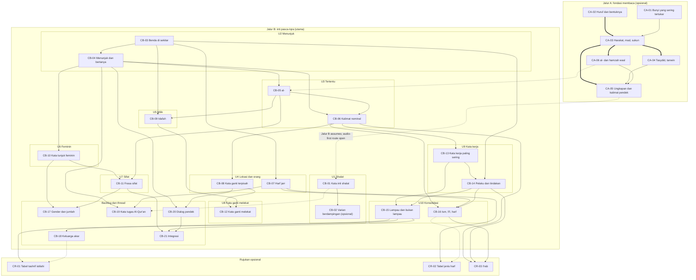

# Competency graph (initial)

> **Status: HYPOTHESIS, PENDING TEACHER REVIEW. DRAFT — NOT LINGUISTICALLY REVIEWED.** The whole graph (nodes, edges, units, outcomes) is a proposal for an Arabic teacher and an ustadz to review ([ADR-004 D-7](../decisions/0004-content-decisions.md#d-7-reviewers)) and for 5 to 10 learners to test. Nothing here is publishable content.
> **Date:** 14 November 2026.
> **Derived from:** [CURRICULUM_COMPARISON.md](../research/CURRICULUM_COMPARISON.md) (field-level evidence for every node), [ADR-004 D-4](../decisions/0004-content-decisions.md#d-4-first-units-of-the-main-path), the [main research doc](../arabic-learning-pedagogy-ux-research-reissued.md) §5, §6.1 and §6.2, and the [content tracker](../content/tracker.md).
> **Modelling credit:** the idea of prerequisite strengths, track-level "assumes" and keeping the path separate from the graph is inspired by OpenLanguageKit (`curriculum/SCHEMA.en.md`, `curriculum/check.py` at SHA `036c313f788a7a7880df80d1c299617fecc588a7`, CC BY-NC 4.0). Inspiration only: no text, data or code was copied, and our definitions are written independently (background, not legal advice).
> **Arabic:** transliterated items only where ADR-004 or our research docs already contain them; otherwise placeholders such as `[ARABIC: core shalat word from RS-04]`.

## 1. Model

**Node (competency).** One observable capability, with an ID that never changes once used (deprecate, do not renumber). Suggested shape for the future lesson schema (tracker F-04), our own design:

```ts
interface Competency {
	id: string; // 'CA-03', 'CB-06', 'CR-01'
	track: 'A' | 'B' | 'reference';
	titleId: string; // Indonesian title
	arabicTerm?: string; // transliteration; spelling per RS-07
	unit: string | 'backlog' | 'thread' | 'reference'; // provisional
	canDo: string; // measurable outcome, two occasions, unseen items
	prerequisites: {
		id: string;
		strength: 'hard' | 'soft' | 'optional';
		reason: string;
		impossibleBecause?: string;
	}[];
	seeAlso: string[]; // undirected links, never used for ordering or gating
	analogyCaveats: string[]; // Indonesian analogy limits (brief quality criteria)
	commonErrors: string[]; // incl. Indonesian L1 transfer, from teacher review
	trackerIds: string[]; // B*, A*, V-*, R-*
	reviews: Review[]; // D-7; empty = not publishable
}
```

**Edge strengths.**

| Strength     | Meaning                                                                                         | UI behaviour                                                                                                     |
| ------------ | ----------------------------------------------------------------------------------------------- | ---------------------------------------------------------------------------------------------------------------- |
| **hard**     | The next activity is **impossible** without it (brief Phase 4). Must carry `impossibleBecause`. | Activity not offered unassisted; an assisted route (audio, transliteration) is offered instead where one exists. |
| **soft**     | Recommended order; the target is much easier with it.                                           | Shown as "disarankan dulu"; "lanjut saja" (continue anyway) always available.                                    |
| **optional** | Helpful background that can be skipped without a warning.                                       | Shown as a link only.                                                                                            |

**Tracks.** Jalur B (main, post-Iqra) **assumes** the decoding capability of CA-05. This is a track-level assumption, not an edge into every node: a learner who cannot yet decode still uses Jalur B through the audio-first route, and only unassisted reading activities are gated (`G-READ`, §4). Placement (RS-08) recommends Jalur A when the diagnostic suggests it; the learner can override.

**Path vs graph.** Units (§3) are the recommended order. Edges are dependencies. A unit order may never contradict an edge (invariant I-5).

## 2. Nodes

Status of every node: **not reviewed**. Titles are Indonesian; terms are transliterated and their spelling waits on RS-07.

| ID    | Title                                          | Arabic term                                                                            | Track     | Unit                | Hard prerequisites | Soft prerequisites  | Optional | Tracker                        |
| ----- | ---------------------------------------------- | -------------------------------------------------------------------------------------- | --------- | ------------------- | ------------------ | ------------------- | -------- | ------------------------------ |
| CA-01 | Membedakan bunyi yang sering tertukar          | makhārij al-ḥurūf                                                                      | A         | A0                  | none               | none                | none     | A0, B0                         |
| CA-02 | Mengenali huruf dan bentuknya                  | ḥurūf hijāʾiyyah _(to confirm)_                                                        | A         | A1                  | none               | none                | none     | A1                             |
| CA-03 | Membaca harakat, vokal panjang, sukun          | harakat, mad, sukun                                                                    | A         | A2                  | CA-02              | CA-01               | none     | A2, R-03                       |
| CA-04 | Membaca tasydid dan tanwin                     | tasydid, tanwin                                                                        | A         | A3                  | CA-03              | none                | none     | A3                             |
| CA-06 | Membaca al- dan hamzah waṣl                    | lam syamsiyah/qamariyah, hamzat al-waṣl                                                | A         | A4                  | CA-03              | none                | none     | A4 (part)                      |
| CA-05 | Membaca ungkapan dan kalimat pendek berharakat | none                                                                                   | A         | A4 (join point)     | CA-03              | CA-04, CA-06        | none     | A4                             |
| CB-01 | Kata inti bacaan shalat                        | Allāhu akbar, subḥāna, rabbī, al-ʿaẓīm, al-aʿlā, as-salāmu ʿalaikum (final list RS-04) | B         | U1                  | none               | none                | none     | V-04, RS-04                    |
| CB-02 | Varian bacaan shalat berdampingan              | riwayat (D-5 fields)                                                                   | B         | U1 (optional panel) | none               | CB-01               | none     | V-04                           |
| CB-03 | Benda di sekitar                               | `[ARABIC: concrete noun from RS-01 list]`                                              | B         | U2                  | none               | none                | none     | B1, V-01                       |
| CB-04 | Menunjuk dan bertanya                          | hādhā, mā, man                                                                         | B         | U2                  | none               | CB-03               | none     | B2, B8                         |
| CB-05 | Yang tertentu: al-                             | al-; maʿrifah / nakirah                                                                | B         | U3                  | none               | CB-04               | CA-06    | B2                             |
| CB-06 | Kalimat nominal sederhana                      | jumlah ismiyyah (term later)                                                           | B         | U3                  | none               | CB-04, CB-05        | none     | B3                             |
| CB-07 | Lokasi dengan ḥarf jarr                        | ḥarf jarr; fī                                                                          | B         | U4                  | none               | CB-03               | none     | B5, R-01                       |
| CB-08 | Kata ganti terpisah                            | ḍamīr munfaṣil                                                                         | B         | U4                  | none               | CB-06               | none     | B4                             |
| CB-09 | Milik: iḍāfah                                  | iḍāfah                                                                                 | B         | U5                  | none               | CB-03, CB-05        | none     | B4                             |
| CB-10 | Kata tunjuk feminin dan penanda gender         | _(forms and terms to confirm)_                                                         | B         | U6                  | none               | CB-04               | none     | B9 (part)                      |
| CB-11 | Frasa sifat                                    | murakkab waṣfī                                                                         | B         | U7                  | none               | CB-05, CB-10        | none     | B3                             |
| CB-12 | Kata ganti melekat                             | ḍamīr muttaṣil                                                                         | B         | U8                  | none               | CB-08, CB-09        | none     | B4                             |
| CB-13 | Kata kerja paling sering                       | qāla, kāna; fiʿl māḍī                                                                  | B         | U9                  | none               | CB-06               | none     | B6, V-03                       |
| CB-14 | Pelaku dan tindakan                            | jumlah fiʿliyyah; fāʿil                                                                | B         | U9                  | none               | CB-03, CB-13        | none     | B6                             |
| CB-15 | Lampau dan bukan lampau                        | fiʿl māḍī, fiʿl muḍāriʿ                                                                | B         | U10                 | none               | CB-13, CB-14        | none     | B7                             |
| CB-16 | Tiga jenis kata                                | ism, fiʿl, ḥarf                                                                        | B         | U10                 | none               | CB-06, CB-07, CB-14 | none     | none                           |
| CB-17 | Gender dan jumlah                              | tunggal, dua, jamak                                                                    | B         | backlog             | none               | CB-10, CB-11        | none     | B9                             |
| CB-18 | Keluarga akar kata                             | jadhr, wazn                                                                            | B         | backlog             | none               | CB-15               | none     | B10                            |
| CB-19 | Kata tugas Al-Qur'an paling sering             | min, fī, inna, ʿalā, alladhī, mā, lā                                                   | B         | thread              | none               | CB-04, CB-07        | CB-01    | V-03                           |
| CB-20 | Bertanya dan dialog pendek                     | none                                                                                   | B         | backlog             | none               | CB-04, CB-08        | none     | B8, B11                        |
| CB-21 | Integrasi dan transfer                         | none                                                                                   | B         | backlog             | none               | CB-11, CB-15, CB-20 | none     | B11, B12                       |
| CR-01 | Tabel tashrif istilahi                         | tashrif istilahi                                                                       | reference | reference           | none               | CB-15               | CB-18    | R-02 (enam bab dasar tersedia) |
| CR-02 | Tabel jenis ḥarf                               | ḥarf jarr, ʿaṭf, nafy, ...                                                             | reference | reference           | none               | CB-07               | CB-16    | R-01                           |
| CR-03 | Iʿrāb: empat keadaan akhir kata                | rafʿ, naṣb, jarr, jazm                                                                 | reference | reference           | none               | CB-06, CB-14, CB-16 | none     | none                           |

## 3. Units (provisional)

Unit order follows ADR-004 D-4. Can-do goals are drafts; outcomes and evidence per node are in [CURRICULUM_COMPARISON.md §5](../research/CURRICULUM_COMPARISON.md#5-competency-records).

| Unit      | Nodes                          | D-4 step                                       | Draft can-do (Indonesian learner voice)                                                               |
| --------- | ------------------------------ | ---------------------------------------------- | ----------------------------------------------------------------------------------------------------- |
| U1        | CB-01 (+ CB-02 optional panel) | Unit 1: core shalat words                      | "Saya tahu arti kata inti yang saya ucapkan dalam shalat."                                            |
| U2        | CB-03, CB-04                   | Pointing words with question words             | "Saya bisa memahami 'ini apa?' dan 'ini siapa?' tentang benda di sekitar."                            |
| U3        | CB-05, CB-06                   | Definite al- (nominal sentence inserted by us) | "Saya bisa membedakan 'sebuah buku' dan 'buku tertentu', dan memahami kalimat pendek tanpa 'adalah'." |
| U4        | CB-07, CB-08                   | Huruf jarr and pronouns                        | "Saya bisa memahami di mana sesuatu berada dan siapa yang dibicarakan."                               |
| U5        | CB-09                          | Iḍāfah                                         | "Saya bisa memahami milik siapa sesuatu."                                                             |
| U6        | CB-10                          | Feminine pointing words                        | "Saya mengenali kata tunjuk untuk kata berjenis feminin."                                             |
| U7        | CB-11                          | Adjective phrase                               | "Saya bisa memahami deskripsi singkat sebuah benda."                                                  |
| U8        | CB-12                          | Attached pronouns                              | "Saya bisa memahami 'bukuku', 'bukumu' dan sejenisnya."                                               |
| U9        | CB-13, CB-14                   | Most frequent verbs                            | "Saya memahami kata kerja paling sering dan siapa melakukan apa."                                     |
| U10       | CB-15, CB-16                   | Not in D-4 (consolidation)                     | "Saya bisa membedakan aksi lampau dan bukan lampau, dan menjelaskan ism, fiʿl, ḥarf dengan contoh."   |
| Thread    | CB-19                          | Not in D-4                                     | Each function word is introduced when it first appears in a unit.                                     |
| Backlog   | CB-17, CB-18, CB-20, CB-21     | Not in D-4                                     | Old B-list items kept as can-do backlog (D-4 point 3).                                                |
| Reference | CR-01, CR-02, CR-03            | Not in D-4                                     | Optional tables and reference pages; never gates.                                                     |
| Jalur A   | CA-01 to CA-06                 | Research doc §5.2                              | Optional foundation; CA-05 is the join point to Jalur B.                                              |

### Cakupan bacaan tingkat menengah

| ID    | Bukti yang dicari dari jawaban pelajar                                                        | Prasyarat yang disarankan |
| ----- | --------------------------------------------------------------------------------------------- | ------------------------- |
| CB-22 | Menjelaskan alasan, akibat, urutan atau kontras dan menunjuk penandanya.                      | CB-07, CB-12, CB-15       |
| CB-23 | Menulis gagasan utama satu paragraf dan memilih satu detail yang mendukungnya.                | CB-22                     |
| CB-24 | Menjelaskan fungsi setiap paragraf, melacak rujukan antarpagraf dan merangkum dokumen pendek. | CB-12, CB-22, CB-23       |

CB-21 tetap menjadi kompetensi transfer. Uji akhir memberi pengumuman baru agar pelajar bisa menerapkan CB-24 pada jenis dokumen yang berbeda. Ketiga node di atas adalah perluasan kasus bacaan dan belum termasuk hitungan grafik awal pada §6. [Daftar pelajaran](../content/public-lessons.md).

## 4. Activity gates

Hard gates live on **activities**, not on whole units, so that a learner is never locked out of meaning-first and listening work.

| Gate       | Kind    | Rule                                                                                                                                                                                                                                                                                                                                                                                                                                                             | Why it is hard                                                                                   |
| ---------- | ------- | ---------------------------------------------------------------------------------------------------------------------------------------------------------------------------------------------------------------------------------------------------------------------------------------------------------------------------------------------------------------------------------------------------------------------------------------------------------------- | ------------------------------------------------------------------------------------------------ |
| `G-READ`   | Learner | An **unassisted** reading item requires CA-03, plus CA-04 if the item contains tasydid or tanwin, plus CA-06 if it contains al- or hamzah waṣl (items are tagged with the marks they contain). Otherwise the item is offered with audio or transliteration support. Provisional placement evidence ([ONBOARDING_SPEC](./ONBOARDING_SPEC.md) §3.4, pending OP-6) counts only for the marks it tested: P-3 for short vowels and sukun, P-4 for tasydid and tanwin. | Reading an unseen vocalised word without these is impossible (brief Phase 4, research doc §6.1). |
| `G-AUDIO`  | Content | A listening item is shown only if its clip has a reviewed audio manifest entry (tracker A-01, A-02, stage 5).                                                                                                                                                                                                                                                                                                                                                    | No reviewed clip, no listening item. Not a learner gate.                                         |
| `G-REVIEW` | Content | A node's items are publishable only with an approving review record (D-7).                                                                                                                                                                                                                                                                                                                                                                                       | Release gate, enforced by the validator (F-06).                                                  |

Everything else is soft or optional, with "lanjut saja" available.

## 5. Diagram

Legend: thick arrow `==>` hard; plain arrow `-->` soft; dotted arrow `-.->` optional or track-level assumption.



The `CA05 -.-> CB01` arrow stands for the track-level assumption in §1, not a node prerequisite. It is excluded from the counts and checks in §6.

## 6. Graph invariants

To be enforced by the build-time validator (tracker F-06) once the graph is data. All invariants hold for the edges in §2 and §7: checked on 14 November 2026 with a throwaway script (30 nodes, 48 edges: 4 hard, 40 soft, 4 optional; no cycle; no edge points backwards in the unit order; no hard edge inside Jalur B; entry nodes CA-01, CA-02, CB-01, CB-03).

| ID   | Invariant                                                                                                                                                                                                                            | Check                                                                                                                                                                                                                                |
| ---- | ------------------------------------------------------------------------------------------------------------------------------------------------------------------------------------------------------------------------------------ | ------------------------------------------------------------------------------------------------------------------------------------------------------------------------------------------------------------------------------------ |
| I-1  | **No cycles**, counting hard, soft and optional edges together.                                                                                                                                                                      | Topological sort succeeds.                                                                                                                                                                                                           |
| I-2  | **Hard edges only where the next activity is impossible.** Every hard edge has a non-empty `impossibleBecause`.                                                                                                                      | Field present; reviewer signs off each hard edge.                                                                                                                                                                                    |
| I-3  | **No hard edge on terminology.** CB-16 and CR-03 (and any node whose outcome is naming terms) can never be the source of a hard edge.                                                                                                | Source-node allow-list.                                                                                                                                                                                                              |
| I-4  | **No hard edge inside Jalur B.** Reading-dependent limits are expressed as `G-READ` activity gates, not node edges.                                                                                                                  | Count of hard edges with both ends in track B = 0.                                                                                                                                                                                   |
| I-5  | **Unit order respects edges.** A hard or soft prerequisite is in an earlier unit or earlier in the same unit; a backwards soft edge is a warning, a backwards hard edge is an error (pattern inspired by OLK `curriculum/check.py`). | Compare unit index of both ends.                                                                                                                                                                                                     |
| I-6  | **Track closure.** Each track's hard prerequisites are inside the track or covered by its `assumes` list (Jalur B assumes CA-05).                                                                                                    | Per-track check.                                                                                                                                                                                                                     |
| I-7  | **Every node reachable** from an entry node, and **no orphan**: every node has at least one edge or is an entry node.                                                                                                                | Graph walk.                                                                                                                                                                                                                          |
| I-8  | **Every node in exactly one place:** a unit, `thread`, `backlog` or `reference`.                                                                                                                                                     | Uniqueness check.                                                                                                                                                                                                                    |
| I-9  | **See-also links never order or gate.** `seeAlso` is a separate field (lesson from UAG, whose links are undirected).                                                                                                                 | Schema.                                                                                                                                                                                                                              |
| I-10 | **Tracker coverage.** Every tracker item in Main path, Foundation path, V-01 to V-05 and R-01 to R-03 maps to at least one node, or is listed as out of scope (idea from OLK's source-unit "denominator", re-implemented).           | Cross-check with `docs/content/tracker.md`. Current gaps: V-05 (short surahs, blocked) has no node yet; V-02 (everyday MSA verbs) has no node yet and is not covered by CB-13, which is limited to the most frequent Qur'anic verbs. |
| I-11 | **Stable IDs.** IDs are never reused or renumbered; retired nodes keep a `deprecated` flag.                                                                                                                                          | Diff check against the previous version.                                                                                                                                                                                             |
| I-12 | **No publishable node without review** (`G-REVIEW`, D-7).                                                                                                                                                                            | Validator.                                                                                                                                                                                                                           |
| I-13 | **"Continue anyway" on every soft edge.**                                                                                                                                                                                            | UI contract test.                                                                                                                                                                                                                    |

## 7. Edge reasons

Every edge with its reason. Hard edges also state why the next activity is impossible.

| From  | To    | Strength | Reason                                                                                                               |
| ----- | ----- | -------- | -------------------------------------------------------------------------------------------------------------------- |
| CA-02 | CA-03 | hard     | A vowel mark cannot be read without identifying the letter that carries it.                                          |
| CA-03 | CA-04 | hard     | Tasydid and tanwin are read together with the vowel marks (wording to confirm with a teacher).                       |
| CA-03 | CA-06 | hard     | Reading al- and hamzah waṣl in context needs vowel decoding.                                                         |
| CA-03 | CA-05 | hard     | Unassisted phrase reading is impossible without vowel decoding.                                                      |
| CA-01 | CA-03 | soft     | Hearing contrasts supports accurate decoding; reading can start without it.                                          |
| CA-04 | CA-05 | soft     | Only phrases containing these marks need it; enforced per item by `G-READ`.                                          |
| CA-06 | CA-05 | soft     | As above, for phrases with al- or hamzah waṣl.                                                                       |
| CA-06 | CB-05 | optional | Reading al- correctly helps, but its meaning can be taught audio-first.                                              |
| CB-01 | CB-02 | soft     | Variants are compared against the shared core words.                                                                 |
| CB-03 | CB-04 | soft     | Pointing needs some nouns to point at; they may be introduced in the same unit.                                      |
| CB-04 | CB-05 | soft     | The al- contrast in research doc §5.3 is built on the pointing word.                                                 |
| CB-04 | CB-06 | soft     | The first pointing sentences are already "X Y" sentences without a written "adalah" (research doc §5.2 B2, B3).      |
| CB-05 | CB-06 | soft     | Short nominal sentences in the research doc use a definite first word.                                               |
| CB-03 | CB-07 | soft     | Location phrases need known nouns.                                                                                   |
| CB-06 | CB-08 | soft     | Pronouns first appear as the first part of short sentences (M4 groups pronouns with sentence types, riset ulang §6). |
| CB-03 | CB-09 | soft     | Iḍāfah pairs known nouns.                                                                                            |
| CB-05 | CB-09 | soft     | The first word of the pair behaves differently from a word with al- (CT-L1-20 lists this).                           |
| CB-04 | CB-10 | soft     | Feminine pointing words extend the pointing words from U2.                                                           |
| CB-10 | CB-11 | soft     | Adjectives agree with the noun's gender (UAG `sifat`).                                                               |
| CB-05 | CB-11 | soft     | Adjectives agree in definiteness (UAG `sifat`); also needed for the phrase vs sentence contrast.                     |
| CB-08 | CB-12 | soft     | Attached forms map onto the independent pronouns (CT-L1-27 builds on CT-L1-26).                                      |
| CB-09 | CB-12 | soft     | The first attached pronouns appear on nouns in a possessive sense (CT-L1-27 builds on CT-L1-20).                     |
| CB-06 | CB-13 | soft     | kāna is treated as operating on the nominal sentence in both CT (CT-L1-11) and UAG (`kana-sisters`).                 |
| CB-13 | CB-14 | soft     | Doer and action sentences use verbs already understood.                                                              |
| CB-03 | CB-14 | soft     | Doers and objects are known nouns.                                                                                   |
| CB-13 | CB-15 | soft     | The past/non-past contrast needs familiar verbs.                                                                     |
| CB-14 | CB-15 | soft     | The contrast is read from whole sentences, not isolated words.                                                       |
| CB-06 | CB-16 | soft     | Naming word classes needs used examples (brief Phase 3, layer 3).                                                    |
| CB-07 | CB-16 | soft     | As above, for ḥarf.                                                                                                  |
| CB-14 | CB-16 | soft     | As above, for fiʿl.                                                                                                  |
| CB-10 | CB-17 | soft     | Gender marker known before wider gender and number.                                                                  |
| CB-11 | CB-17 | soft     | Agreement known before number agreement.                                                                             |
| CB-15 | CB-18 | soft     | Root families after several verb meanings are known (research doc §5.3).                                             |
| CB-04 | CB-19 | soft     | mā already met as a question word.                                                                                   |
| CB-07 | CB-19 | soft     | fī already met as a location word.                                                                                   |
| CB-01 | CB-19 | optional | Shalat context can anchor Qur'anic function words.                                                                   |
| CB-04 | CB-20 | soft     | Questions are the core of short dialogues.                                                                           |
| CB-08 | CB-20 | soft     | Dialogues need pronouns.                                                                                             |
| CB-11 | CB-21 | soft     | Paragraphs contain descriptions.                                                                                     |
| CB-15 | CB-21 | soft     | Paragraphs contain past and non-past actions.                                                                        |
| CB-20 | CB-21 | soft     | Paragraph and dialogue comprehension build on short exchanges.                                                       |
| CB-15 | CR-01 | soft     | A tashrif table is reference for forms already understood (research doc §6.1a).                                      |
| CB-18 | CR-01 | optional | Root awareness helps but is not needed to use the table.                                                             |
| CB-07 | CR-02 | soft     | At least one ḥarf type is understood in context.                                                                     |
| CB-16 | CR-02 | optional | The ḥarf label helps but is not needed.                                                                              |
| CB-06 | CR-03 | soft     | End states are shown on known sentence types.                                                                        |
| CB-14 | CR-03 | soft     | As above, for verbal sentences.                                                                                      |
| CB-16 | CR-03 | soft     | Word classes known before end states (soft only: invariant I-3).                                                     |

## 8. Open points for the reviewers

1. Is any soft edge actually hard, or any hard edge (§7, first four rows) actually soft?
2. Should CB-06 (nominal sentence) be named in U3, or kept implicit until later?
3. Should CB-19 function words be a thread, or a unit of its own?
4. Where should V-05 (short surahs word by word) sit once the tashih question (RS-09, RS-10) is answered?
5. Do the Jalur A nodes cover what adult Iqra graduates actually lack (RS-08)?
