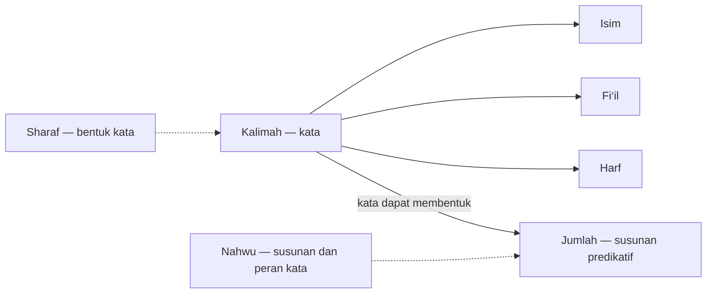

# Glosarium istilah Arab untuk pelajar pasca-Iqra

**15 November 2026 · Usulan**

Di halaman Bedah per kata, pelajar dapat menemukan _isim_, _nahwu_, _sharaf_, dan beberapa istilah baru dalam satu contoh. Ia perlu tahu apa yang perlu dilihat pada contoh tersebut sebelum memutuskan apakah ingin mempelajari kaidahnya. Mulai dari pelajaran “Isim, fi‘il, dan harf”. [Temuan PR #28](https://github.com/faiz-muttaqin/belajar-bahasa-arab/pull/28) · [Audit UX](../research/2026-11-15-ux-pasca-iqra.md).

## Dari istilah di pelajaran ke rujukan

1. Pada kemunculan pertama yang penting, tampilkan bantuan singkat dalam kalimat. Istilah yang dapat diketuk diberi label dan gaya tautan yang konsisten. Hindari membuat setiap pengulangan istilah menjadi kontrol.
2. Ketuk istilah untuk membuka dialog ringkas. Isinya satu definisi Indonesia, satu contoh Arab berharakat dengan arti, dan satu kalimat yang menunjuk apa yang perlu diperhatikan. Gunakan tombol Tutup yang terlihat. Pada ponsel, isi boleh digulir jika ruang terbatas.
3. Tautan “Baca penjelasan lengkap” membuka halaman istilah dengan URL yang dapat ditautkan. Halaman itu memuat makna umum dan teknis, cakupan, pembagian yang berguna, contoh penggunaan, analogi Indonesia, serta efek terhadap makna, susunan, atau harakat jika relevan.
4. Tanpa JavaScript, tautan yang sama membuka rujukan statis. Setelah dialog ditutup, fokus kembali ke istilah dan posisi baca tetap. Uji urutan fokus, tombol Escape, keyboard, pembaca layar, serta campuran RTL dan LTR pada lebar 320 px. [Pola dialog WAI-ARIA](https://www.w3.org/WAI/ARIA/apg/patterns/dialog-modal/).

## Istilah pertama

| Istilah        | Definisi awal untuk ditinjau                                                                                                                   | Dalami di halaman istilah                                                                                                                                                                                 |
| -------------- | ---------------------------------------------------------------------------------------------------------------------------------------------- | --------------------------------------------------------------------------------------------------------------------------------------------------------------------------------------------------------- |
| Isim · اِسْم     | “Nama” sebagai salah satu makna umum. Dalam tata bahasa, isim adalah kelompok kata yang mencakup kata benda, nama, kata sifat, dan kata ganti. | Mulai dari “buku”, “baru”, dan “dia”. Bedakan jenis kata dari tugasnya dalam kalimat. Perlihatkan bagaimana fungsi isim atau kata yang mendahuluinya bisa memengaruhi tanda akhir pada contoh yang cocok. |
| Fi‘il · فِعْل    | Kata kerja. Bentuknya dapat menyatakan tindakan atau keadaan.                                                                                  | Mulai dari “menulis”, lalu kenalkan bentuk lampau, nonlampau, dan perintah. Tunjukkan satu contoh saat partikel mengubah makna atau bentuk fi‘il.                                                         |
| Harf · حَرْف     | Dalam pembagian jenis kata, harf adalah kata tugas seperti فِي (“di”), dengan fungsi yang tampak ketika dipakai bersama kata lain.              | Bedakan kata tugas dari huruf penyusun tulisan. Perlihatkan dampak فِي pada harakat akhir isim dalam contoh yang sesuai.                                                                                   |
| Kalimah · كَلِمَة | Dalam pembagian jenis kata Arab, _kalimah_ berarti **kata**. Istilah Indonesia “kalimat” berada pada tingkat susunan kata.                     | Pakai catatan singkat di kemunculan pertama dan tautkan ke _jumlah_. Tampilkan “buku” dan “buku itu baru” agar bedanya langsung terlihat.                                                                 |
| Jumlah · جُمْلَة  | Dalam pelajaran tata bahasa ini, _jumlah_ mengacu pada susunan predikatif, seperti “buku itu baru”.                                            | Bedakan dari “jumlah” yang berarti banyaknya sesuatu dalam bahasa Indonesia. Mulai dari jumlah nominal dan verbal, lalu jelaskan pemakaian sebagai klausa ketika relevan.                                 |
| Nahwu · نَحْو    | Membantu kita melihat bagaimana kata berhubungan dan apa tugasnya dalam susunan.                                                               | Tunjukkan perbedaan “pintu yang terbuka” dan “pintu itu terbuka”. Buka pembahasan harakat akhir setelah pelajar memahami perannya.                                                                        |
| Sharaf · صَرْف   | Membantu kita mengenali bentuk kata dan cara pembentukannya.                                                                                   | Pakai keluarga kata dari materi yang sudah ada. Tunjukkan perubahan bentuk dan arti, lalu tautkan ke nahwu untuk peran bentuk itu dalam contoh.                                                           |

Definisi di atas adalah draf untuk pengajar. Gunakan materi internal yang sudah bersumber dan tulis contoh atau analogi Indonesia secara orisinal. Bedakan makna umum, istilah gramatikal, dan pemakaian tradisi tertentu jika diperlukan. [Bedah jenis kata](../content/public-lessons.md) · [Peta nahwu–sharaf](./nahwu-sharaf-knowledge-map.md) · [Ibn Hishām, _Qaṭr al-Nadā_, bagian kata dan jenisnya](https://rissc.jo/wp-content/uploads/2024/10/QatrNada_21-10-24.pdf).

## Cakupan ilustrasi

Untuk pilot, pakai satu ilustrasi berlabel yang membandingkan bentuk kata dengan tugasnya dalam kalimat. Di layar sempit, sajikan urutan vertikal dan sediakan penjelasan teks yang setara. Warna boleh membantu menandai kata dan hubungannya. Label serta penjelasan harus tetap terbaca sendiri.

## Tahap pengembangan

- **Pilot.** Tulis entri _isim_, _kalimah_, dan _jumlah_. Siapkan satu rujukan statis per entri dan satu dialog singkat yang menggunakan data entri yang sama. Tempatkan tautan pada contoh pertama yang membutuhkannya dalam pelajaran jenis kata.
- **Perluasan.** Setelah uji pelajar, tambahkan _fi‘il_, _harf_, _nahwu_, dan _sharaf_. Pakai entri yang sama dari Kaidah, Jenis kata, dan pelajaran terkait. Tambahkan ilustrasi serta rincian teknis dari pertanyaan yang muncul saat pilot.
- **Uji penerimaan.** Saat membaca contoh, pelajar dapat menemukan arti _isim_ dalam satu tindakan, menjelaskan perbedaan _kalimah_ dan “kalimat” dengan contoh, lalu kembali tepat ke contoh semula. Gunakan tugas uji tanpa menyebut label tombol. Ulangi tanpa JavaScript untuk memeriksa tautan rujukan statis.
